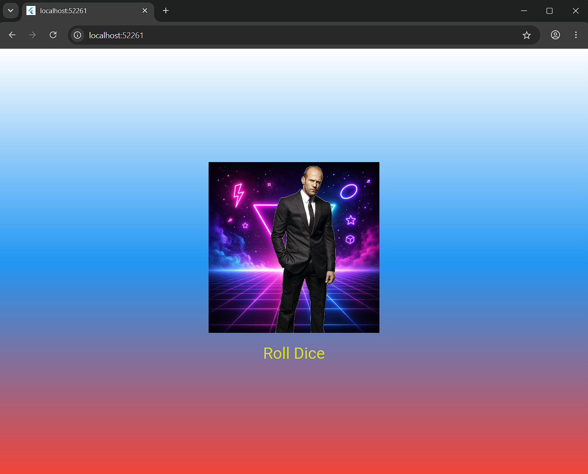

# Лабораторная работа №4-5. Flutter: структура UI и компонентный подход

Приложение Roll Dice App, созданное на Flutter. При нажатии на кнопку показывает случайную игральную кость на фоне градиента.

## Информация об авторе

Студент: Колесников Владислав Александрович
Группа: ИСП-241

## Что изучили

1. Научились выносить виджеты в отдельные файлы и классы.
2. Разобрались, как передавать данные через параметры конструктора (final поля).
3. Изучили разницу между StatelessWidget и StatefulWidget.
4. Поняли, как работает setState() для обновления интерфейса.
5. Научились подключать локальные картинки (assets) через pubspec.yaml.

## Скриншот приложения

## Ссылка на репозиторий

[GitHub репозиторий](https://github.com/Demor865/Dart_4-5_laba_Flutter_Widgets)

## Инструкция по запуску

1. Клонировать репозиторий: `git clone <https://github.com/Demor865/Dart_4-5_laba_Flutter_Widgets>`
2. Перейти в папку: `cd flutter_widgets_kolesnikov`
3. Установить зависимости: `flutter pub get`
4. Запустить: `flutter run -d chrome`

## Ответы на вопросы

**1. Зачем выносить виджеты в отдельные файлы? Что изменится если держать всё в main.dart?**
Выносить виджеты нужно для чистоты кода. Если держать всё в main.dart, файл очень быстро разрастётся до сотен строк, в нём станет невозможно ориентироваться (каша). Отдельные файлы позволяют переиспользовать виджеты в разных местах, а также упрощают командную работу — каждый может писать свой виджет в своём файле.

**2. Что такое BuildContext? Почему метод build() принимает его как параметр?**
BuildContext — это объект, который содержит информацию о том, где находится виджет в дереве виджетов (что-то вроде его адреса). Метод build() принимает его, чтобы виджет мог найти своих родителей, узнать тему приложения (цвета, шрифты) или размеры экрана.

**3. Чем StatelessWidget отличается от StatefulWidget? Приведите пример когда нужен каждый из них.**
StatelessWidget — это неизменяемый виджет. Он рисуется один раз и не меняется (например, наш StyledText или GradientContainer). StatefulWidget — это изменяемый виджет, он хранит состояние и может перерисовываться при вызове setState() (например, наш DiceRoller, где картинка меняется при нажатии на кнопку).

**4. Почему Random() создаётся на уровне файла, а не внутри rollDice()?**
Если создавать Random() внутри функции rollDice(), то при каждом нажатии на кнопку будет создаваться новый генератор случайных чисел. Это неэффективно с точки зрения памяти. Создав один объект на уровне файла, мы просто переиспользуем его при каждом клике, что работает быстрее и правильнее.
